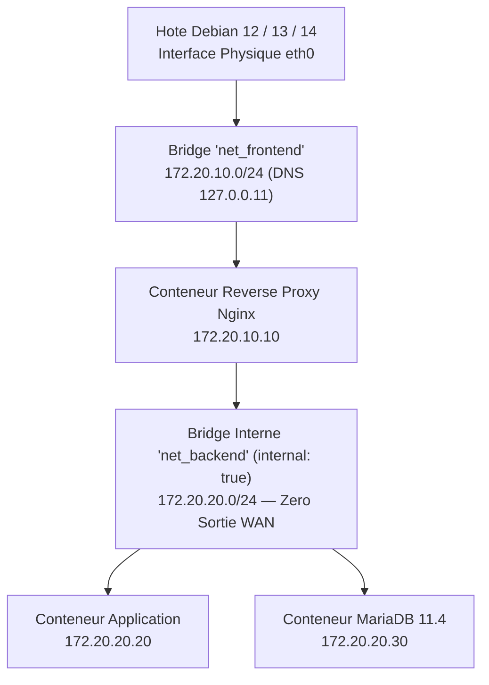

<!-- MASTER-HEADER-START -->
<div align="center">

<a href="https://0xcyberlitech.com/">
  
</a>

<p align="center">
  <a href="https://0xcyberlitech.com/"></a>
  <a href="https://0xcyberlitech.com/soc-rd.html"></a>
  <a href="https://0xcyberlitech.com/jarvis-rd.html"></a>
  <a href="https://github.com/0xCyberLiTech?tab=repositories"></a>
</p>
<p align="center">
  <a href="README.md"></a>
</p>


</div>
<!-- MASTER-HEADER-END -->

<!-- DEBIAN-TRUTH-START -->
> [!IMPORTANT]
>  ** Matrice Officielle Debian — `Debian 12 (Bookworm)` · `Debian 13 (Trixie)` · `Debian 14 (Forky)`**
> - **Sources Officielles Debian.org (`docker.io`) :** `Bookworm (12)` : **`20.10.24+dfsg1-1+deb12u1`** &nbsp;·&nbsp; `Trixie (13 — Stable)` : **`26.1.5+dfsg1-9+deb13u1`** &nbsp;·&nbsp; `Forky (14 — Next-Gen)` : **`28.5.2+dfsg4-5`**
> - **Références Officielles :** [Paquet Debian Trixie (`docker.io`)](https://packages.debian.org/trixie/docker.io) &nbsp;·&nbsp; [Paquet Debian Forky (`docker.io`)](https://packages.debian.org/forky/docker.io) &nbsp;·&nbsp; [Documentation Officielle Debian](https://wiki.debian.org/Docker)
> - **Note d'Ingénierie (Divergence 13 vs 14) :** Sous Debian 13 (Trixie) et Debian 14 (Forky), `apt-key` et l'ancien binaire Compose v1 n'existent plus : on utilise exclusivement `/etc/apt/keyrings/`, le format DEB822 `.sources` et **`docker compose` v2**.

<details>
<summary> <b>Afficher les Encarts Ligne de Commande : Debian 13 (Trixie — Stable) vs Debian 14 (Forky — Next-Gen)</b></summary>

####  Profil Production Stable — Commandes pour `Debian 13 (Trixie)`
```bash
# Debian 13 (Trixie) — Depot Docker au format moderne DEB822 (.sources) :
sudo install -m 0755 -d /etc/apt/keyrings
sudo curl -fsSL https://download.docker.com/linux/debian/gpg -o /etc/apt/keyrings/docker.asc
docker compose version && docker compose ps
```

####  Profil Anticipation Next-Gen — Commandes pour `Debian 14 (Forky)`
```bash
# Debian 14 (Forky) — Fichier /etc/apt/sources.list.d/docker.sources (Format DEB822 APT 3.0) :
# Types: deb
# URIs: https://download.docker.com/linux/debian
# Suites: trixie
# Components: stable
# Signed-By: /etc/apt/keyrings/docker.asc
```

</details>
<!-- DEBIAN-TRUTH-END -->

<!-- CIEL-PEDAGOGY-START -->
<details>
<summary> <b>Synthèse d'Architecture, Standards Officiels &amp; Diagnostic (Niveau 1 : Fondamentaux · Niveau 2 : Repères · Niveau 3 : Diagnostic)</b></summary>

- **Niveau 1 — Fondamentaux &amp; Principe d'Architecture :** **Docker Engine & Docker Compose** permettent d'isoler et d'exécuter des services applicatifs dans des **conteneurs légers** partageant le noyau Linux de l'hôte grâce aux primitives d'isolation du noyau (**Namespaces** et **cgroups v2**).
- **Niveau 2 — Repères Officiels (Ports IANA, Fichiers Debian &amp; Commandes de Validation) :** **Fichiers & Commandes :** `/etc/docker/daemon.json`, `compose.yaml` &nbsp;|&nbsp; **Validation & Exploitation :** `docker compose config` (validation syntaxique), `docker compose up -d`, `docker ps`, `docker inspect`, `docker network ls`.
- **Niveau 3 — Diagnostic d'Incidents &amp; Ingénierie Avancée :** **Diagnostic & Architecture :** Le réseau `bridge` par défaut (`docker0`) n'assure pas la résolution DNS par nom de conteneur ; déclarez toujours un **réseau bridge dédié** (`docker network create` ou via `compose.yaml`) afin d'activer le serveur DNS embarqué de Docker (`127.0.0.11`). Une **Image** est un modèle immuable en couches (OverlayFS), tandis qu'un **Conteneur** est son instance d'exécution.
- **Sources de Vérité Officielles Éditeurs &amp; Standards :** [Documentation Officielle Docker Engine](https://docs.docker.com/engine/) &nbsp;·&nbsp; [Spécification Officielle Docker Compose](https://docs.docker.com/compose/)

</details>
<!-- CIEL-PEDAGOGY-END -->


#  DOCKER RÉSEAU — Créer et Administrer un Réseau Personnalisé Bridge (Debian 12, 13 & 14)

> **Objectif Opérationnel :** Maîtriser la création, l'isolation et l'administration de **réseaux personnalisés `bridge` (User-Defined Bridge Networks)** sous **Docker Engine & Docker Compose v2** sur **Debian 12 (Bookworm)**, **Debian 13 (Trixie — Stable)** et **Debian 14 (Forky — Next-Gen)**, avec résolution DNS automatique entre conteneurs et filtrage pare-feu.

---

##  01 // Pourquoi utiliser un réseau `bridge` personnalisé plutôt que `bridge0` par défaut ?


Par défaut, Docker attache les conteneurs non configurés au pont `docker0` (`172.17.0.0/16`). Ce réseau par défaut présente trois limites majeures en production :
1. **Pas de résolution DNS automatique par nom de conteneur** (obligation d'utiliser des adresses IP éphémères).
2. **Absence de cloisonnement** : tous les conteneurs partagent le même domaine de diffusion L2.
3. **Gestion manuelle des règles `nftables` / `iptables`**.

Un **réseau `bridge` personnalisé (User-Defined Bridge)** intègre nativement le serveur DNS embarqué de Docker (`127.0.0.11`) et isole strictement chaque pile applicative.



---

##  02 // Création d'un Réseau `bridge` Personnalisé en CLI (`docker network create`)


Créez un réseau `bridge` avec plan d'adressage IPAM explicite (`172.20.10.0/24`), passerelle dédiée et nom d'interface Linux lisible (`br-cyber-front`) :

<!-- CODE-WINDOW-START -->
> [!CAUTION]
> 
>
> ```bash
> sudo docker network create \
>   --driver bridge \
>   --subnet 172.20.10.0/24 \
>   --ip-range 172.20.10.128/25 \
>   --gateway 172.20.10.1 \
>   --opt com.docker.network.bridge.name=br-cyber-front \
>   net_frontend
> ```
<!-- CODE-WINDOW-END -->

Pour un réseau de base de données strictement isolé d'Internet, ajoutez l'option `--internal` :

<!-- CODE-WINDOW-START -->
> [!CAUTION]
> 
>
> ```bash
> sudo docker network create \
>   --driver bridge \
>   --internal \
>   --subnet 172.20.20.0/24 \
>   --gateway 172.20.20.1 \
>   --opt com.docker.network.bridge.name=br-cyber-back \
>   net_backend
> ```
<!-- CODE-WINDOW-END -->

Vérifiez la liste des réseaux Docker et l'interface créée dans le noyau Debian :

<!-- CODE-WINDOW-START -->
> [!CAUTION]
> 
>
> ```bash
> sudo docker network ls
> ip -c addr show br-cyber-front
> ```
<!-- CODE-WINDOW-END -->

---

##  03 // Connexion de Conteneurs et Vérification du DNS Interne (`127.0.0.11`)


Lancez deux conteneurs sur le réseau `net_frontend` et testez la résolution DNS automatique par nom :

<!-- CODE-WINDOW-START -->
> [!CAUTION]
> 
>
> ```bash
> sudo docker run -dit --name srv-web --network net_frontend nginx:stable-alpine
> sudo docker run --rm --network net_frontend alpine:latest ping -c 3 srv-web
> ```
<!-- CODE-WINDOW-END -->

Vous pouvez également connecter ou déconnecter à chaud un conteneur existant :

<!-- CODE-WINDOW-START -->
> [!CAUTION]
> 
>
> ```bash
> sudo docker network connect net_backend srv-web
> sudo docker network inspect net_frontend
> ```
<!-- CODE-WINDOW-END -->

---

##  04 // Déclaration Industrielle avec Docker Compose v2 (`docker-compose.yml`)


Sous **Debian 12, 13 (Trixie) et 14 (Forky)** avec **Docker Compose v2**, déclarez vos réseaux `bridge` personnalisés (frontend exposé + backend interne isolé) directement dans votre fichier `compose.yml` :

<!-- CODE-WINDOW-START -->
> [!CAUTION]
> 
>
> ```yaml
> services:
>   reverse-proxy:
>     image: nginx:stable-alpine
>     container_name: reverse-proxy
>     restart: unless-stopped
>     ports:
>       - "443:443"
>     networks:
>       net_frontend:
>         ipv4_address: 172.20.10.10
>       net_backend:
>         ipv4_address: 172.20.20.10
>
>   mariadb-db:
>     image: mariadb:11.4
>     container_name: mariadb-db
>     restart: unless-stopped
>     environment:
>       MARIADB_ROOT_PASSWORD: "ChangeMe_StrongRootPass!"
>     networks:
>       net_backend:
>         ipv4_address: 172.20.20.30
>
> networks:
>   net_frontend:
>     driver: bridge
>     driver_opts:
>       com.docker.network.bridge.name: br-cyber-front
>     ipam:
>       config:
>         - subnet: 172.20.10.0/24
>           gateway: 172.20.10.1
>
>   net_backend:
>     driver: bridge
>     internal: true
>     driver_opts:
>       com.docker.network.bridge.name: br-cyber-back
>     ipam:
>       config:
>         - subnet: 172.20.20.0/24
>           gateway: 172.20.20.1
> ```
<!-- CODE-WINDOW-END -->

Déployez et contrôlez la pile :

<!-- CODE-WINDOW-START -->
> [!CAUTION]
> 
>
> ```bash
> sudo docker compose up -d
> sudo docker compose ps
> ```
<!-- CODE-WINDOW-END -->

---

##  05 // Diagnostic, Audit et Nettoyage des Réseaux Docker


<!-- CODE-WINDOW-START -->
> [!CAUTION]
> 
>
> ```bash
> # Inspecter la table d'adressage IP des conteneurs sur net_backend :
> sudo docker network inspect -f '{{range .Containers}}{{.Name}} -> {{.IPv4Address}}{{println}}{{end}}' net_backend
>
> # Supprimer tous les reseaux personnalises non utilises :
> sudo docker network prune -f
> ```
<!-- CODE-WINDOW-END -->

<!-- MASTER-FOOTER-START -->
<div align="center">


<a href="https://0xcyberlitech.com/">
  
</a>

<p align="center"><a href="https://0xcyberlitech.com/"></a></p>

<sub><b>Architecturé &amp; Forgé par Marc &amp; Antigravity (Google DeepMind)</b> &nbsp;·&nbsp; <a href="https://0xcyberlitech.com/"><b>0xcyberlitech.com</b></a> &nbsp;·&nbsp; <a href="https://0xcyberlitech.com/soc-rd.html">Architecture SOC Cockpit v5.5</a> &nbsp;·&nbsp; <a href="https://0xcyberlitech.com/jarvis-rd.html">Architecture JARVIS Mark-VII</a> &nbsp;·&nbsp; <a href="https://0xcyberlitech.com/blueprint-jarvis.html">Blueprint Matériel RTX 5080</a></sub>

</div>
<!-- MASTER-FOOTER-END -->
