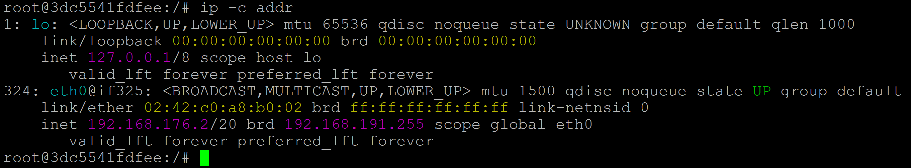
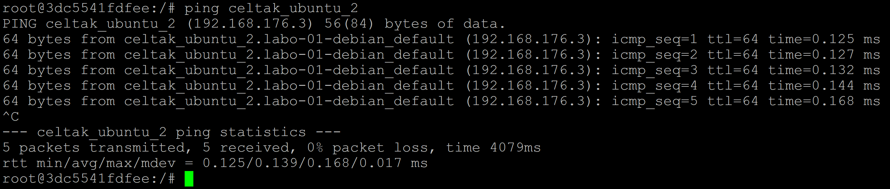
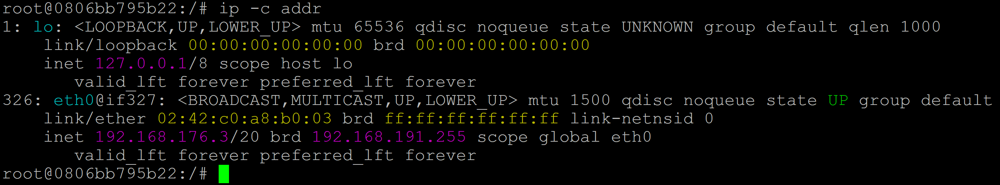
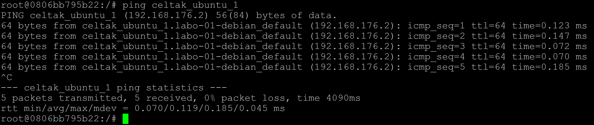
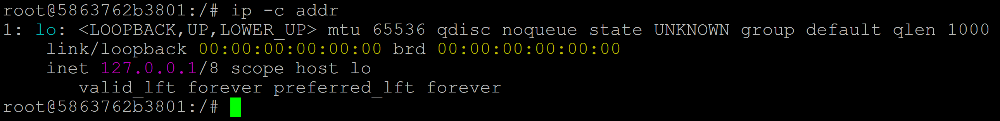
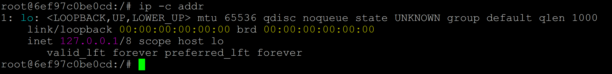
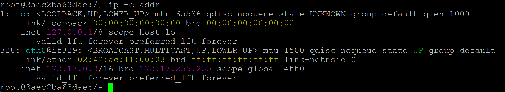

<!-- MASTER-HEADER-START -->
<div align="center">

<a href="https://0xcyberlitech.com/">
  
</a>

<p align="center">
  <a href="https://0xcyberlitech.com/"></a>
  <a href="https://0xcyberlitech.com/soc-rd.html"></a>
  <a href="https://0xcyberlitech.com/jarvis-rd.html"></a>
  <a href="https://github.com/0xCyberLiTech?tab=repositories"></a>
</p>
<p align="center">
  <a href="README.md"></a>
</p>


</div>
<!-- MASTER-HEADER-END -->

<!-- DEBIAN-TRUTH-START -->
> [!IMPORTANT]
>  ** Matrice Officielle Debian — `Debian 12 (Bookworm)` · `Debian 13 (Trixie)` · `Debian 14 (Forky)`**
> - **Sources Officielles Debian.org (`docker.io`) :** `Bookworm (12)` : **`20.10.24+dfsg1-1+deb12u1`** &nbsp;·&nbsp; `Trixie (13 — Stable)` : **`26.1.5+dfsg1-9+deb13u1`** &nbsp;·&nbsp; `Forky (14 — Next-Gen)` : **`28.5.2+dfsg4-5`**
> - **Références Officielles :** [Paquet Debian Trixie (`docker.io`)](https://packages.debian.org/trixie/docker.io) &nbsp;·&nbsp; [Paquet Debian Forky (`docker.io`)](https://packages.debian.org/forky/docker.io) &nbsp;·&nbsp; [Documentation Officielle Debian](https://wiki.debian.org/Docker)
> - **Note d'Ingénierie (Divergence 13 vs 14) :** Sous Debian 13 (Trixie) et Debian 14 (Forky), `apt-key` et l'ancien binaire Compose v1 n'existent plus : on utilise exclusivement `/etc/apt/keyrings/`, le format DEB822 `.sources` et **`docker compose` v2**.

<details>
<summary> <b>Afficher les Encarts Ligne de Commande : Debian 13 (Trixie — Stable) vs Debian 14 (Forky — Next-Gen)</b></summary>

####  Profil Production Stable — Commandes pour `Debian 13 (Trixie)`
```bash
# Debian 13 (Trixie) — Depot Docker au format moderne DEB822 (.sources) :
sudo install -m 0755 -d /etc/apt/keyrings
sudo curl -fsSL https://download.docker.com/linux/debian/gpg -o /etc/apt/keyrings/docker.asc
docker compose version && docker compose ps
```

####  Profil Anticipation Next-Gen — Commandes pour `Debian 14 (Forky)`
```bash
# Debian 14 (Forky) — Fichier /etc/apt/sources.list.d/docker.sources (Format DEB822 APT 3.0) :
# Types: deb
# URIs: https://download.docker.com/linux/debian
# Suites: trixie
# Components: stable
# Signed-By: /etc/apt/keyrings/docker.asc
```

</details>
<!-- DEBIAN-TRUTH-END -->

<!-- CIEL-PEDAGOGY-START -->
<details>
<summary> <b>Synthèse d'Architecture, Standards Officiels &amp; Diagnostic (Niveau 1 : Fondamentaux · Niveau 2 : Repères · Niveau 3 : Diagnostic)</b></summary>

- **Niveau 1 — Fondamentaux &amp; Principe d'Architecture :** **Docker Engine & Docker Compose** permettent d'isoler et d'exécuter des services applicatifs dans des **conteneurs légers** partageant le noyau Linux de l'hôte grâce aux primitives d'isolation du noyau (**Namespaces** et **cgroups v2**).
- **Niveau 2 — Repères Officiels (Ports IANA, Fichiers Debian &amp; Commandes de Validation) :** **Fichiers & Commandes :** `/etc/docker/daemon.json`, `compose.yaml` &nbsp;|&nbsp; **Validation & Exploitation :** `docker compose config` (validation syntaxique), `docker compose up -d`, `docker ps`, `docker inspect`, `docker network ls`.
- **Niveau 3 — Diagnostic d'Incidents &amp; Ingénierie Avancée :** **Diagnostic & Architecture :** Le réseau `bridge` par défaut (`docker0`) n'assure pas la résolution DNS par nom de conteneur ; déclarez toujours un **réseau bridge dédié** (`docker network create` ou via `compose.yaml`) afin d'activer le serveur DNS embarqué de Docker (`127.0.0.11`). Une **Image** est un modèle immuable en couches (OverlayFS), tandis qu'un **Conteneur** est son instance d'exécution.
- **Sources de Vérité Officielles Éditeurs &amp; Standards :** [Documentation Officielle Docker Engine](https://docs.docker.com/engine/) &nbsp;·&nbsp; [Spécification Officielle Docker Compose](https://docs.docker.com/compose/)
- **Livres Blancs &amp; 67 Podcasts Audio R&amp;D :** [Portail 0xCyberLiTech](https://0xcyberlitech.com/) &nbsp;·&nbsp; [Livre Blanc SOC Cockpit v5.5](https://0xcyberlitech.com/soc-rd.html) &nbsp;·&nbsp; [Livre Blanc JARVIS Mark-VII](https://0xcyberlitech.com/jarvis-rd.html) &nbsp;·&nbsp; [Blueprint Logiciel &amp; Matériel RTX 5080](https://0xcyberlitech.com/blueprint-jarvis.html)

</details>
<!-- CIEL-PEDAGOGY-END -->


##  01 // DOCKER RÉSEAU - Isoler un conteneur Docker du réseau


Pour atteindre cet objectif, nous allons recourir à none.

Rappel communication entre deux containers :

<!-- CODE-WINDOW-START -->
> [!CAUTION]
> 
>
> ```yaml
> version: '3.8'
>
> services:
>   my_ubuntu_1:
>     image: celtak/ubuntu-ping-ip
>     container_name: celtak_ubuntu_1
>     stdin_open: true
>     tty: true
>
>   my_ubuntu_2:
>     image: celtak/ubuntu-ping-ip
>     container_name: celtak_ubuntu_2
>     stdin_open: true
>     tty: true
> ```
<!-- CODE-WINDOW-END -->

<!-- CODE-WINDOW-START -->
> [!CAUTION]
> 
>
> ```bash
> docker compose up -d
> ```
<!-- CODE-WINDOW-END -->

<!-- CODE-WINDOW-START -->
> [!CAUTION]
> 
>
> ```bash
> docker ps
> ```
<!-- CODE-WINDOW-END -->

Depuis le container celtak_ubuntu_1

<!-- CODE-WINDOW-START -->
> [!CAUTION]
> 
>
> ```bash
> docker exec -it (celtak_ubuntu_1) bash
> ```
<!-- CODE-WINDOW-END -->

<!-- CODE-WINDOW-START -->
> [!CAUTION]
> 
>
> ```bash
> ip -c addr
> ```
<!-- CODE-WINDOW-END -->



<!-- CODE-WINDOW-START -->
> [!CAUTION]
> 
>
> ```bash
> ping celtak_ubuntu_2
> ```
<!-- CODE-WINDOW-END -->



Depuis le container celtak_ubuntu_2

<!-- CODE-WINDOW-START -->
> [!CAUTION]
> 
>
> ```bash
> docker exec -it (celtak_ubuntu_2) bash
> ```
<!-- CODE-WINDOW-END -->

<!-- CODE-WINDOW-START -->
> [!CAUTION]
> 
>
> ```bash
> ip -c addr
> ```
<!-- CODE-WINDOW-END -->



<!-- CODE-WINDOW-START -->
> [!CAUTION]
> 
>
> ```bash
> ping celtak_ubuntu_1
> ```
<!-- CODE-WINDOW-END -->



Nous pouvons constater que ces deux containers (celtak_ubuntu_1) et (celtak_ubuntu_2) discutent entre eux.

Arrêter et supprimer ces deux containers

À présent repartons de zéro :

Faisons un test et tapons cette commande dans deux terminaux différents pour avoir deux containers.

Maintenant, nous allons vérifier si les conteneurs sont bien isolés, l'un de l'autre (plus de connexion réseau).

C'est normalement le cas puisque le pilote none a été utilisé.

Pour ce faire nous allons utiliser une commande que nous connaissons désormais très bien.

Il faut la taper sur les deux terminaux.

<!-- CODE-WINDOW-START -->
> [!CAUTION]
> 
>
> ```bash
> ip -c a
> ```
<!-- CODE-WINDOW-END -->

Depuis le terminal 01 :

<!-- CODE-WINDOW-START -->
> [!CAUTION]
> 
>
> ```bash
> docker run --rm -it --network=none celtak/ubuntu-ping-ip
> ```
<!-- CODE-WINDOW-END -->

<!-- CODE-WINDOW-START -->
> [!CAUTION]
> 
>
> ```bash
> root@5863762b3801:/#
> ```
<!-- CODE-WINDOW-END -->

<!-- CODE-WINDOW-START -->
> [!CAUTION]
> 
>
> ```bash
> ip -c a
> ```
<!-- CODE-WINDOW-END -->



Depuis le terminal 02 :

<!-- CODE-WINDOW-START -->
> [!CAUTION]
> 
>
> ```bash
> docker run --rm -it --network=none celtak/ubuntu-ping-ip
> ```
<!-- CODE-WINDOW-END -->

<!-- CODE-WINDOW-START -->
> [!CAUTION]
> 
>
> ```bash
> root@6ef97c0be0cd:/#
> ```
<!-- CODE-WINDOW-END -->

<!-- CODE-WINDOW-START -->
> [!CAUTION]
> 
>
> ```bash
> ip -c a
> ```
<!-- CODE-WINDOW-END -->



Que voyons-nous  ?

On s'aperçoit que les deux conteneurs ne sont pas relié par un réseau.

Il n'y a pas d'adresse IP associé.

Pour être certain de cela, nous allons ouvrir une autre fenêtre dans notre terminal.

Un troisième conteneur va etre mis en service.

Ensuite nous allons taper la même commande que précédemment, mais en omettant le paramètre --network=none.

Par conséquent, Docker va attribuer un réseau automatiquement à notre conteneur.

<!-- CODE-WINDOW-START -->
> [!CAUTION]
> 
>
> ```bash
> docker run --rm -it celtak/ubuntu-ping-ip
> ```
<!-- CODE-WINDOW-END -->



<!-- MASTER-FOOTER-START -->
<div align="center">


<a href="https://0xcyberlitech.com/">
  
</a>

<p align="center"><a href="https://0xcyberlitech.com/"></a></p>

<sub><b>Architecturé &amp; Forgé par Marc &amp; Antigravity (Google DeepMind)</b> &nbsp;·&nbsp; <a href="https://0xcyberlitech.com/"><b>0xcyberlitech.com</b></a> &nbsp;·&nbsp; <a href="https://0xcyberlitech.com/soc-rd.html">Architecture SOC Cockpit v5.5</a> &nbsp;·&nbsp; <a href="https://0xcyberlitech.com/jarvis-rd.html">Architecture JARVIS Mark-VII</a> &nbsp;·&nbsp; <a href="https://0xcyberlitech.com/blueprint-jarvis.html">Blueprint Matériel RTX 5080</a></sub>

</div>
<!-- MASTER-FOOTER-END -->
