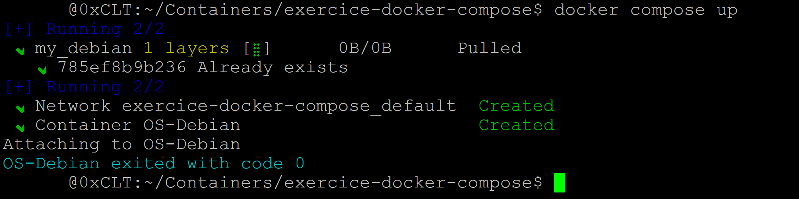
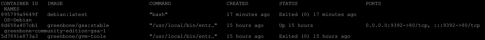
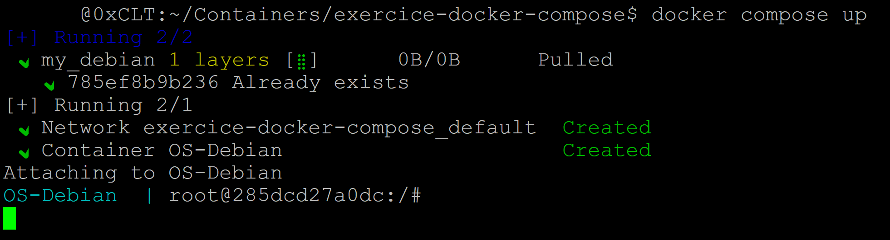
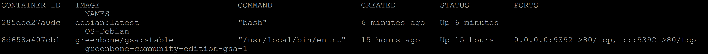

<!-- MASTER-HEADER-START -->
<div align="center">

<a href="https://0xcyberlitech.com/">
  
</a>

<p align="center">
  <a href="https://0xcyberlitech.com/"></a>
  <a href="https://0xcyberlitech.com/soc-rd.html"></a>
  <a href="https://0xcyberlitech.com/jarvis-rd.html"></a>
  <a href="https://github.com/0xCyberLiTech?tab=repositories"></a>
</p>
<p align="center">
  <a href="README.md"></a>
</p>


</div>
<!-- MASTER-HEADER-END -->

<!-- DEBIAN-TRUTH-START -->
> [!IMPORTANT]
>  ** Matrice Officielle Debian — `Debian 12 (Bookworm)` · `Debian 13 (Trixie)` · `Debian 14 (Forky)`**
> - **Sources Officielles Debian.org (`docker.io`) :** `Bookworm (12)` : **`20.10.24+dfsg1-1+deb12u1`** &nbsp;·&nbsp; `Trixie (13 — Stable)` : **`26.1.5+dfsg1-9+deb13u1`** &nbsp;·&nbsp; `Forky (14 — Next-Gen)` : **`28.5.2+dfsg4-5`**
> - **Références Officielles :** [Paquet Debian Trixie (`docker.io`)](https://packages.debian.org/trixie/docker.io) &nbsp;·&nbsp; [Paquet Debian Forky (`docker.io`)](https://packages.debian.org/forky/docker.io) &nbsp;·&nbsp; [Documentation Officielle Debian](https://wiki.debian.org/Docker)
> - **Note d'Ingénierie (Divergence 13 vs 14) :** Sous Debian 13 (Trixie) et Debian 14 (Forky), `apt-key` et l'ancien binaire Compose v1 n'existent plus : on utilise exclusivement `/etc/apt/keyrings/`, le format DEB822 `.sources` et **`docker compose` v2**.

<details>
<summary> <b>Afficher les Encarts Ligne de Commande : Debian 13 (Trixie — Stable) vs Debian 14 (Forky — Next-Gen)</b></summary>

####  Profil Production Stable — Commandes pour `Debian 13 (Trixie)`
```bash
# Debian 13 (Trixie) — Depot Docker au format moderne DEB822 (.sources) :
sudo install -m 0755 -d /etc/apt/keyrings
sudo curl -fsSL https://download.docker.com/linux/debian/gpg -o /etc/apt/keyrings/docker.asc
docker compose version && docker compose ps
```

####  Profil Anticipation Next-Gen — Commandes pour `Debian 14 (Forky)`
```bash
# Debian 14 (Forky) — Fichier /etc/apt/sources.list.d/docker.sources (Format DEB822 APT 3.0) :
# Types: deb
# URIs: https://download.docker.com/linux/debian
# Suites: trixie
# Components: stable
# Signed-By: /etc/apt/keyrings/docker.asc
```

</details>
<!-- DEBIAN-TRUTH-END -->

<!-- CIEL-PEDAGOGY-START -->
<details>
<summary> <b>Synthèse d'Architecture, Standards Officiels &amp; Diagnostic (Niveau 1 : Fondamentaux · Niveau 2 : Repères · Niveau 3 : Diagnostic)</b></summary>

- **Niveau 1 — Fondamentaux &amp; Principe d'Architecture :** **Docker Engine & Docker Compose** permettent d'isoler et d'exécuter des services applicatifs dans des **conteneurs légers** partageant le noyau Linux de l'hôte grâce aux primitives d'isolation du noyau (**Namespaces** et **cgroups v2**).
- **Niveau 2 — Repères Officiels (Ports IANA, Fichiers Debian &amp; Commandes de Validation) :** **Fichiers & Commandes :** `/etc/docker/daemon.json`, `compose.yaml` &nbsp;|&nbsp; **Validation & Exploitation :** `docker compose config` (validation syntaxique), `docker compose up -d`, `docker ps`, `docker inspect`, `docker network ls`.
- **Niveau 3 — Diagnostic d'Incidents &amp; Ingénierie Avancée :** **Diagnostic & Architecture :** Le réseau `bridge` par défaut (`docker0`) n'assure pas la résolution DNS par nom de conteneur ; déclarez toujours un **réseau bridge dédié** (`docker network create` ou via `compose.yaml`) afin d'activer le serveur DNS embarqué de Docker (`127.0.0.11`). Une **Image** est un modèle immuable en couches (OverlayFS), tandis qu'un **Conteneur** est son instance d'exécution.
- **Sources de Vérité Officielles Éditeurs &amp; Standards :** [Documentation Officielle Docker Engine](https://docs.docker.com/engine/) &nbsp;·&nbsp; [Spécification Officielle Docker Compose](https://docs.docker.com/compose/)

</details>
<!-- CIEL-PEDAGOGY-END -->


##  01 // DOCKER leçon 01 - Débuter avec Docker.


Créer un fichier docker-compose.yml.

Pour bien débuter, je vous propose de créer un nouveau dossier quelque-part sur votre ordinateur. Et dans celui-ci, nous mettrons le fichier docker-compose.yml.

Ce fichier doit absolument porter le nom docker-compose.yml.

Créer le sous dossier exercice-docker-compose

<!-- CODE-WINDOW-START -->
> [!CAUTION]
> 
>
> ```bash
> mkdir -p ~/Containers/exercice-docker-compose/
> ```
<!-- CODE-WINDOW-END -->

<!-- CODE-WINDOW-START -->
> [!CAUTION]
> 
>
> ```bash
> cd /Containers/exercice-docker-compose/
> ```
<!-- CODE-WINDOW-END -->

<!-- CODE-WINDOW-START -->
> [!CAUTION]
> 
>
> ```bash
> touch docker-compose.yml
> ```
<!-- CODE-WINDOW-END -->

Ouvrez le fichier docker-compose.yml via votre éditeur de texte préféré. Ensuite commencez par inscrire le numéro de la version.

##  02 // Services.


Après nous allons nous occuper des services.

<!-- CODE-WINDOW-START -->
> [!CAUTION]
> 
>
> ```yaml
> version: '3'
>
>
> services:
> ```
<!-- CODE-WINDOW-END -->

Un service représente une image.

Plusieurs subdivisions existent pour bien décrire ce que nous souhaitons faire. 

Commençons par y inscrire celles que nous utiliseront et puis on expliquera leur signification.

<!-- CODE-WINDOW-START -->
> [!CAUTION]
> 
>
> ```yaml
> version: '3.8'
>
> services:
>   my_debian:
>     image: debian:latest
>     container_name: OS-Debian
> ```
<!-- CODE-WINDOW-END -->

Ces instructions nous indiquent, qu'un seul conteneur sera lancé. 

(my_debian) est le nom du bloc. 

La ligne commençant par (image) indique l'image que nous utiliserons. 

Et enfin container_name est le nom donné à notre conteneur (OS-Debian).

Exécuter docker-compose.yml :

Pour exécuter notre docker-compose.yml, il faut se trouver dans le répertoire qui contient le fichier en question (s'il n'y a pas de fichier portant le nom docker-compose.yml ou docker-compose.yaml, cela ne fonctionnera pas).

Et on tape la commande qui suit.

<!-- CODE-WINDOW-START -->
> [!CAUTION]
> 
>
> ```bash
> docker compose up
> ```
<!-- CODE-WINDOW-END -->



L'image va être téléchargée (si celle-ci n'est déjà pas présente dans notre machine). 

Le conteneur va être créé et ensuite automatiquement arrêté.

Mais il sera bien présent (mais pas démarré).

<!-- CODE-WINDOW-START -->
> [!CAUTION]
> 
>
> ```bash
> docker ps -a
> ```
<!-- CODE-WINDOW-END -->



Mais voilà, le conteneur s'est arrêté et nous n'avons pas pu interagir avec lui.

Pour y remédier nous allons ajouter deux lignes à notre fichier.

<!-- CODE-WINDOW-START -->
> [!CAUTION]
> 
>
> ```yaml
> version: '3.8'
>
> services:
>   my_debian:
>     image: debian:latest
>     container_name: OS-Debian
>     stdin_open: true
>     tty: true
> ```
<!-- CODE-WINDOW-END -->

Sauvegardez le fichier et tapez de nouveau la commande qui suit.

<!-- CODE-WINDOW-START -->
> [!CAUTION]
> 
>
> ```bash
> docker compose up
> ```
<!-- CODE-WINDOW-END -->



Le conteneur est lancé. Maintenant ouvrez un autre terminal et tapez la commande suivante.

<!-- CODE-WINDOW-START -->
> [!CAUTION]
> 
>
> ```bash
> docker ps
> ```
<!-- CODE-WINDOW-END -->



Nous voyons bien notre conteneur qui a été lancé et ne s'est pas arrêté

Pour interagir directement avec celui-ci copier et coller la commande ci-dessous.

<!-- CODE-WINDOW-START -->
> [!CAUTION]
> 
>
> ```bash
> docker exec -it 23a278e4bf2b bash
> ```
<!-- CODE-WINDOW-END -->

<!-- CODE-WINDOW-START -->
> [!CAUTION]
> 
>
> ```bash
>     @srv-linux-01:~/Containers/exercice-docker-compose$ docker exec -it 23a278e4bf2b bash
> root@23a278e4bf2b:/#
> ```
<!-- CODE-WINDOW-END -->

Nous sommes bien entrés dans le conteneur.

Tapez exit pour sortir et cliquez sur la combinaison ctrl + C sur l'autre terminal pour arrêter le conteneur.

##  03 // Détacher le conteneur du terminal.


Il est possible de faire la même chose, mais en détachant le conteneur du terminal.

Celui-ci tournera alors en arrière-plan. 

Il suffit pour cela d'ajouter l'option -d.

<!-- CODE-WINDOW-START -->
> [!CAUTION]
> 
>
> ```bash
> docker compose up -d
> ```
<!-- CODE-WINDOW-END -->

##  04 // Arrêter.


Pour arrêter le conteneur, exécuter la commande suivante.

<!-- CODE-WINDOW-START -->
> [!CAUTION]
> 
>
> ```bash
> docker compose stop
> ```
<!-- CODE-WINDOW-END -->

Pour supprimer notre conteneur, exécuter la commande suivante.

<!-- CODE-WINDOW-START -->
> [!CAUTION]
> 
>
> ```bash
> docker compose rm
> ```
<!-- CODE-WINDOW-END -->

<!-- MASTER-FOOTER-START -->
<div align="center">


<a href="https://0xcyberlitech.com/">
  
</a>

<p align="center"><a href="https://0xcyberlitech.com/"></a></p>

<sub><b>Architecturé &amp; Forgé par Marc &amp; Antigravity (Google DeepMind)</b> &nbsp;·&nbsp; <a href="https://0xcyberlitech.com/"><b>0xcyberlitech.com</b></a> &nbsp;·&nbsp; <a href="https://0xcyberlitech.com/soc-rd.html">Architecture SOC Cockpit v5.5</a> &nbsp;·&nbsp; <a href="https://0xcyberlitech.com/jarvis-rd.html">Architecture JARVIS Mark-VII</a> &nbsp;·&nbsp; <a href="https://0xcyberlitech.com/blueprint-jarvis.html">Blueprint Matériel RTX 5080</a></sub>

</div>
<!-- MASTER-FOOTER-END -->
