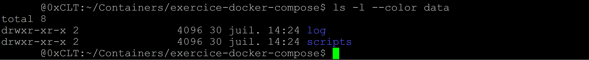
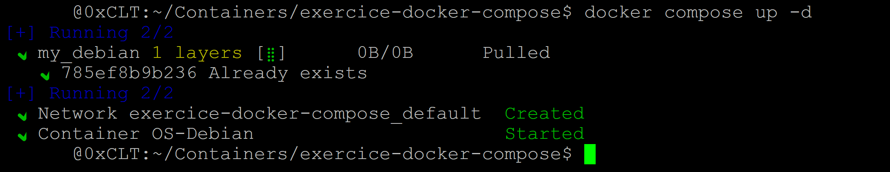
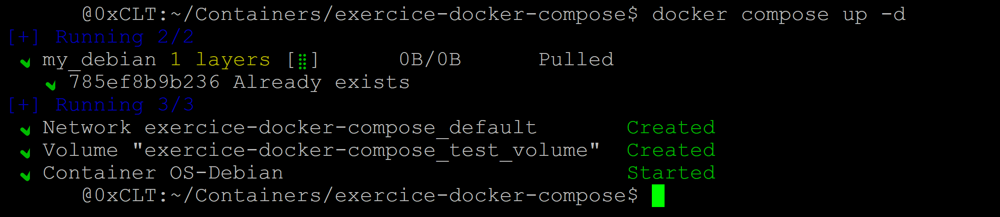

<!-- MASTER-HEADER-START -->
<div align="center">

<a href="https://0xcyberlitech.com/">
  
</a>

<p align="center">
  <a href="https://0xcyberlitech.com/"></a>
  <a href="https://0xcyberlitech.com/soc-rd.html"></a>
  <a href="https://0xcyberlitech.com/jarvis-rd.html"></a>
  <a href="https://github.com/0xCyberLiTech?tab=repositories"></a>
</p>
<p align="center">
  <a href="README.md"></a>
</p>


</div>
<!-- MASTER-HEADER-END -->

<!-- DEBIAN-TRUTH-START -->
> [!IMPORTANT]
>  ** Matrice Officielle Debian — `Debian 12 (Bookworm)` · `Debian 13 (Trixie)` · `Debian 14 (Forky)`**
> - **Sources Officielles Debian.org (`docker.io`) :** `Bookworm (12)` : **`20.10.24+dfsg1-1+deb12u1`** &nbsp;·&nbsp; `Trixie (13 — Stable)` : **`26.1.5+dfsg1-9+deb13u1`** &nbsp;·&nbsp; `Forky (14 — Next-Gen)` : **`28.5.2+dfsg4-5`**
> - **Références Officielles :** [Paquet Debian Trixie (`docker.io`)](https://packages.debian.org/trixie/docker.io) &nbsp;·&nbsp; [Paquet Debian Forky (`docker.io`)](https://packages.debian.org/forky/docker.io) &nbsp;·&nbsp; [Documentation Officielle Debian](https://wiki.debian.org/Docker)
> - **Note d'Ingénierie (Divergence 13 vs 14) :** Sous Debian 13 (Trixie) et Debian 14 (Forky), `apt-key` et l'ancien binaire Compose v1 n'existent plus : on utilise exclusivement `/etc/apt/keyrings/`, le format DEB822 `.sources` et **`docker compose` v2**.

<details>
<summary> <b>Afficher les Encarts Ligne de Commande : Debian 13 (Trixie — Stable) vs Debian 14 (Forky — Next-Gen)</b></summary>

####  Profil Production Stable — Commandes pour `Debian 13 (Trixie)`
```bash
# Debian 13 (Trixie) — Depot Docker au format moderne DEB822 (.sources) :
sudo install -m 0755 -d /etc/apt/keyrings
sudo curl -fsSL https://download.docker.com/linux/debian/gpg -o /etc/apt/keyrings/docker.asc
docker compose version && docker compose ps
```

####  Profil Anticipation Next-Gen — Commandes pour `Debian 14 (Forky)`
```bash
# Debian 14 (Forky) — Fichier /etc/apt/sources.list.d/docker.sources (Format DEB822 APT 3.0) :
# Types: deb
# URIs: https://download.docker.com/linux/debian
# Suites: trixie
# Components: stable
# Signed-By: /etc/apt/keyrings/docker.asc
```

</details>
<!-- DEBIAN-TRUTH-END -->

<!-- CIEL-PEDAGOGY-START -->
<details>
<summary> <b>Synthèse d'Architecture, Standards Officiels &amp; Diagnostic (Niveau 1 : Fondamentaux · Niveau 2 : Repères · Niveau 3 : Diagnostic)</b></summary>

- **Niveau 1 — Fondamentaux &amp; Principe d'Architecture :** **Docker Engine & Docker Compose** permettent d'isoler et d'exécuter des services applicatifs dans des **conteneurs légers** partageant le noyau Linux de l'hôte grâce aux primitives d'isolation du noyau (**Namespaces** et **cgroups v2**).
- **Niveau 2 — Repères Officiels (Ports IANA, Fichiers Debian &amp; Commandes de Validation) :** **Fichiers & Commandes :** `/etc/docker/daemon.json`, `compose.yaml` &nbsp;|&nbsp; **Validation & Exploitation :** `docker compose config` (validation syntaxique), `docker compose up -d`, `docker ps`, `docker inspect`, `docker network ls`.
- **Niveau 3 — Diagnostic d'Incidents &amp; Ingénierie Avancée :** **Diagnostic & Architecture :** Le réseau `bridge` par défaut (`docker0`) n'assure pas la résolution DNS par nom de conteneur ; déclarez toujours un **réseau bridge dédié** (`docker network create` ou via `compose.yaml`) afin d'activer le serveur DNS embarqué de Docker (`127.0.0.11`). Une **Image** est un modèle immuable en couches (OverlayFS), tandis qu'un **Conteneur** est son instance d'exécution.
- **Sources de Vérité Officielles Éditeurs &amp; Standards :** [Documentation Officielle Docker Engine](https://docs.docker.com/engine/) &nbsp;·&nbsp; [Spécification Officielle Docker Compose](https://docs.docker.com/compose/)

</details>
<!-- CIEL-PEDAGOGY-END -->


##  01 // DOCKER leçon 02 - Volume.


- Volume mappé
- Volume managé

Exploiter les volumes dans le docker-compose.yml.

Utiliser les volumes dans le fichier docker-compose.yml.

Il est possible d'utiliser des volumes mappés et/ou managés.

##  02 // Volume mappé :


Partons de notre docker-compose.yml initial.

<!-- CODE-WINDOW-START -->
> [!CAUTION]
> 
>
> ```bash
> cd ~/Containers/exercice-docker-compose
> ```
<!-- CODE-WINDOW-END -->

<!-- CODE-WINDOW-START -->
> [!CAUTION]
> 
>
> ```yaml
> version: '3.8'
>
> services:
>   my_debian:
>     image: debian:latest
>     container_name: OS-Debian
>     stdin_open: true
>     tty: true
> ```
<!-- CODE-WINDOW-END -->

Ajoutons des instructions correspondant au volume mappé.

<!-- CODE-WINDOW-START -->
> [!CAUTION]
> 
>
> ```yaml
> version: '3.8'
>
> services:
>   my_debian:
>     image: debian:latest
>     container_name: OS-Debian
>     stdin_open: true
>     tty: true
>
>     volumes:
>       - ./data/scripts:/usr/local/bin
>       - ./data/log:/var/log
> ```
<!-- CODE-WINDOW-END -->

 Expliquons ce que nous avons ajouté.

- C'est-à-dire volumes et - ./data/scripts:/usr/local/bin
- C'est-à-dire volumes et - ./data/log:/var/log

L'indication (./data/scripts) et (./data/log) correspond au nom du dossier local et (:/usr/local/bin) et (:/var/log) au nom du dossier dans le conteneur. 

Ces deux seront liés.

- (- ./data/scripts:/usr/local/bin)
- (- ./data/log:/var/log)

Le : est un séparateur.

 Notez que dans notre docker-compose.yml, ./data/scripts et ./data/log est précédé d'un (./) alors que (/usr/local/bin) et (/var/log) juste d'un (/). 

Cela signifie que (data/scripts) et (data/log) se trouveront dans le même dossier que docker-compose.yml dans notre machine locale et (/usr/local/bin) et (/var/log) seront placés à la racine du conteneur. 

Bien entendu, si nous le désirons, nous pouvons changer l'emplacement et le nom des dossiers. 

Il faudra juste adapter notre docker-compose.yml.

Avant de lancer notre docker-compose.yml, nous allons créer le dossier (data/scripts) et (data/log) dans notre machine locale. Il faudra les placer dans le même dossier ou adapté le chemin.

<!-- CODE-WINDOW-START -->
> [!CAUTION]
> 
>
> ```bash
> cd ~/Containers/exercice-docker-compose
> ```
<!-- CODE-WINDOW-END -->

<!-- CODE-WINDOW-START -->
> [!CAUTION]
> 
>
> ```bash
> mkdir -p data/scripts
> mkdir -p data/log
> ```
<!-- CODE-WINDOW-END -->



Nous allons ensuite exécuter le docker-compose.yml.

<!-- CODE-WINDOW-START -->
> [!CAUTION]
> 
>
> ```bash
> docker compose up -d
> ```
<!-- CODE-WINDOW-END -->



Pour entrer dans le conteneur créé grâce à la commande docker exec -it <id du conteneur> bash.

Vous pouvez trouver cet id grâce au docker ps.

Maintenant que nous sommes dans notre conteneur, nous allons créer un fichier nommé test.sh dans /usr/local/bin.

<!-- CODE-WINDOW-START -->
> [!CAUTION]
> 
>
> ```bash
> root@9f75a4bd896f:/# cd /usr/local/bin/
> root@9f75a4bd896f:/usr/local/bin# touch test.sh
> root@9f75a4bd896f:/usr/local/bin# ls -l
> total 0
> -rw-r--r-- 1 root root 0 Jul 30 12:40 test.sh
> root@9f75a4bd896f:/usr/local/bin#
> ```
<!-- CODE-WINDOW-END -->

Pour resortir du container exécuter la command exit.

À présent, ouvrons une autre fenêtre de notre terminal.

Cette fois-ci nous n'entrerons pas dans le conteneur, mais nous resterons dans notre machine locale. 
Via la commande cd, allons dans le dossier contenant notre dossier data/scripts et data/log.

<!-- CODE-WINDOW-START -->
> [!CAUTION]
> 
>
> ```bash
> cd ~/Containers/exercice-docker-compose
> ```
<!-- CODE-WINDOW-END -->

Avec la commande ls, vérifions le contenu de (data/scripts).

Nous avions créer un fichier sur le container vers /usr/local/bin nommé test.sh.

<!-- CODE-WINDOW-START -->
> [!CAUTION]
> 
>
> ```bash
> ls -l data/scripts/*
> ```
<!-- CODE-WINDOW-END -->

<!-- CODE-WINDOW-START -->
> [!CAUTION]
> 
>
> ```bash
> -rw-r--r-- 1 root root 0 30 juil. 14:40 data/scripts/test.sh
> ```
<!-- CODE-WINDOW-END -->

Le fichier créé dans notre conteneur apparaît bien.

C'est le cas parce que nous avons configuré notre docker-compose.yml de telle sorte que le dossier data.scripts en local soit lié avec le dossier /usr/local/bin de notre conteneur.

 D'ailleurs l'inverse est également vrai.

Si je crée un fichier dans data/scripts, il sera automatiquement /usr/local/bin.

##  03 // Volume managé.


Pour partir de zéro, nous allons supprimer le conteneur précédemment créé.

Mettons-nous dans le dossier qui contient notre docker-compose.yml et tapons la commande suivante.

<!-- CODE-WINDOW-START -->
> [!CAUTION]
> 
>
> ```bash
> truncate -s 0 docker-compose.yml
> ```
<!-- CODE-WINDOW-END -->

Ensuite nous allons nous occuper du docker-compose.yml et supprimer le volume créé précédemment.

<!-- CODE-WINDOW-START -->
> [!CAUTION]
> 
>
> ```bash
> sudo rm -rf data
> ```
<!-- CODE-WINDOW-END -->

Après, nous allons ajouter le volume managé. 

Les choses se feront un peu différemment.

<!-- CODE-WINDOW-START -->
> [!CAUTION]
> 
>
> ```yaml
> version: '3.8'
>
> services:
>   my_debian:
>     image: debian:latest
>     container_name: OS-Debian
>     stdin_open: true
>     tty: true
>
> volumes:
>   test_volume:
> ```
<!-- CODE-WINDOW-END -->

Cette fois-ci il faut utiliser le mot clé (volumes:) et ensuite créer un volume. 

Par exemple test_volume: comme indiqué ci-dessus. Mais vous pouvez choisir un autre nom.

Quoi faire ensuite ?

Eh bien, tout simplement, la procédure qui suit est la même que pour les volumes mappés.

Nous allons juste changer le nom du dossier dans le conteneur.

<!-- CODE-WINDOW-START -->
> [!CAUTION]
> 
>
> ```yaml
> version: '3.8'
>
> services:
>   my_debian:
>     image: debian:latest
>     container_name: OS-Debian
>     stdin_open: true
>     tty: true
>     volumes:
>       - test_volume:/test-volume-dans-le-conteneur
>
> volumes:
>   test_volume:
> ```
<!-- CODE-WINDOW-END -->

Tester le fonctionnement.

Pour tester, nous allons relancer notre conteneur.

<!-- CODE-WINDOW-START -->
> [!CAUTION]
> 
>
> ```bash
> docker compose up -d
> ```
<!-- CODE-WINDOW-END -->



Puis nous allons entrer dans le conteneur nouvellement créé, via docker exec -it <id du conteneur> bash.

<!-- CODE-WINDOW-START -->
> [!CAUTION]
> 
>
> ```bash
> docker exec -it b7da8cf14e49 bash
> ```
<!-- CODE-WINDOW-END -->

<!-- CODE-WINDOW-START -->
> [!CAUTION]
> 
>
> ```bash
> root@b7da8cf14e49:/#
> ```
<!-- CODE-WINDOW-END -->

Pour y vérifier le contenu.

<!-- CODE-WINDOW-START -->
> [!CAUTION]
> 
>
> ```bash
> ls
> ```
<!-- CODE-WINDOW-END -->

<!-- CODE-WINDOW-START -->
> [!CAUTION]
> 
>
> ```bash
> lrwxrwxrwx   1 root root    7 Jul 25 00:00 bin -> usr/bin
> drwxr-xr-x   2 root root 4096 Jul 14 16:00 boot
> drwxr-xr-x   5 root root  360 Jul 30 13:04 dev
> drwxr-xr-x   1 root root 4096 Jul 30 13:04 etc
> drwxr-xr-x   2 root root 4096 Jul 14 16:00 home
> lrwxrwxrwx   1 root root    7 Jul 25 00:00 lib -> usr/lib
> lrwxrwxrwx   1 root root    9 Jul 25 00:00 lib32 -> usr/lib32
> lrwxrwxrwx   1 root root    9 Jul 25 00:00 lib64 -> usr/lib64
> lrwxrwxrwx   1 root root   10 Jul 25 00:00 libx32 -> usr/libx32
> drwxr-xr-x   2 root root 4096 Jul 25 00:00 media
> drwxr-xr-x   2 root root 4096 Jul 25 00:00 mnt
> drwxr-xr-x   2 root root 4096 Jul 25 00:00 opt
> dr-xr-xr-x 487 root root    0 Jul 30 13:04 proc
> drwx------   2 root root 4096 Jul 25 00:00 root
> drwxr-xr-x   3 root root 4096 Jul 25 00:00 run
> lrwxrwxrwx   1 root root    8 Jul 25 00:00 sbin -> usr/sbin
> drwxr-xr-x   2 root root 4096 Jul 25 00:00 srv
> dr-xr-xr-x  13 root root    0 Jul 30 13:04 sys
> drwxr-xr-x   2 root root 4096 Jul 30 13:04 test-volume-dans-le-conteneur
> drwxrwxrwt   2 root root 4096 Jul 25 00:00 tmp
> drwxr-xr-x  14 root root 4096 Jul 25 00:00 usr
> drwxr-xr-x  11 root root 4096 Jul 25 00:00 var
> ```
<!-- CODE-WINDOW-END -->

<!-- CODE-WINDOW-START -->
> [!CAUTION]
> 
>
> ```bash
> drwxr-xr-x   2 root root 4096 Jul 30 13:04 test-volume-dans-le-conteneur
> ```
<!-- CODE-WINDOW-END -->

Nous voyons bien le dossier test-volume-dans-le-conteneur

Sortons du conteneur avec la commande exit.

Puisque c'est un volume managé, normalement celui-ci devrait apparaître ci nous tapons la commande qui suit.

<!-- CODE-WINDOW-START -->
> [!CAUTION]
> 
>
> ```bash
> docker volume ls
> ```
<!-- CODE-WINDOW-END -->

<!-- CODE-WINDOW-START -->
> [!CAUTION]
> 
>
> ```bash
> DRIVER    VOLUME NAME
> local     exercice-docker-compose_test_volume
> local     greenbone-community-edition_cert_data_vol
> local     greenbone-community-edition_data_objects_vol
> local     greenbone-community-edition_gpg_data_vol
> local     greenbone-community-edition_gvmd_data_vol
> local     greenbone-community-edition_gvmd_socket_vol
> local     greenbone-community-edition_notus_data_vol
> local     greenbone-community-edition_ospd_openvas_socket_vol
> local     greenbone-community-edition_psql_data_vol
> local     greenbone-community-edition_psql_socket_vol
> local     greenbone-community-edition_redis_socket_vol
> local     greenbone-community-edition_scap_data_vol
> local     greenbone-community-edition_vt_data_vol
> local     portainer_data
> ```
<!-- CODE-WINDOW-END -->

<!-- CODE-WINDOW-START -->
> [!CAUTION]
> 
>
> ```bash
> DRIVER    VOLUME NAME
> local     exercice-docker-compose_test_volume
> ```
<!-- CODE-WINDOW-END -->

Et c'est effectivement vrai.

Mais peut-être que vous vous demandez d'où sort ce nom à rallonge : exercice-docker-compose_test_volume.

Pourquoi un nom à rallonge ?

C'est très simple à comprendre. 

Il faut diviser le nom en deux parties :

- 1) La première partie correspond au nom du dossier qui contient le docker-compose.yml (exercice-docker-compose). 

- 2) Et la deuxième partie au nom du volume choisi (test_volume).

<!-- MASTER-FOOTER-START -->
<div align="center">


<a href="https://0xcyberlitech.com/">
  
</a>

<p align="center"><a href="https://0xcyberlitech.com/"></a></p>

<sub><b>Architecturé &amp; Forgé par Marc &amp; Antigravity (Google DeepMind)</b> &nbsp;·&nbsp; <a href="https://0xcyberlitech.com/"><b>0xcyberlitech.com</b></a> &nbsp;·&nbsp; <a href="https://0xcyberlitech.com/soc-rd.html">Architecture SOC Cockpit v5.5</a> &nbsp;·&nbsp; <a href="https://0xcyberlitech.com/jarvis-rd.html">Architecture JARVIS Mark-VII</a> &nbsp;·&nbsp; <a href="https://0xcyberlitech.com/blueprint-jarvis.html">Blueprint Matériel RTX 5080</a></sub>

</div>
<!-- MASTER-FOOTER-END -->
