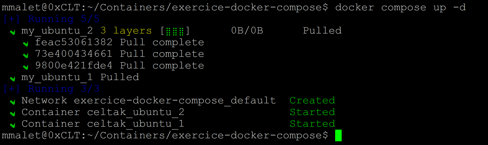
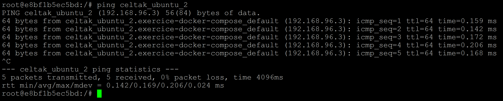
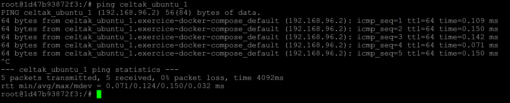
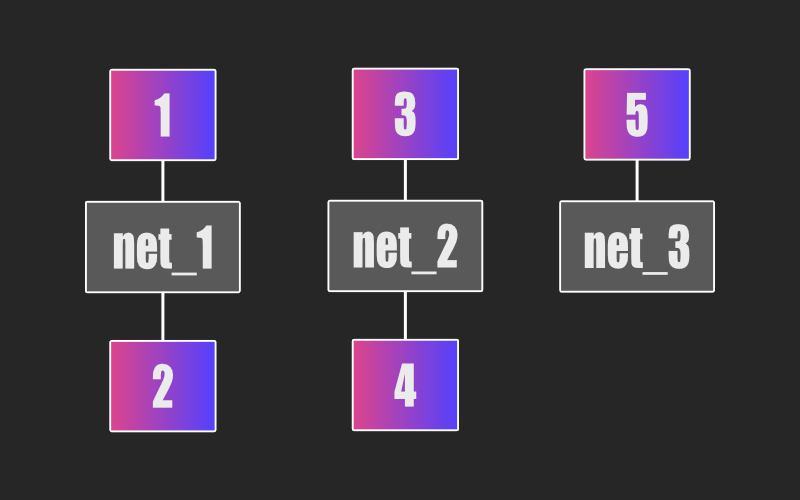
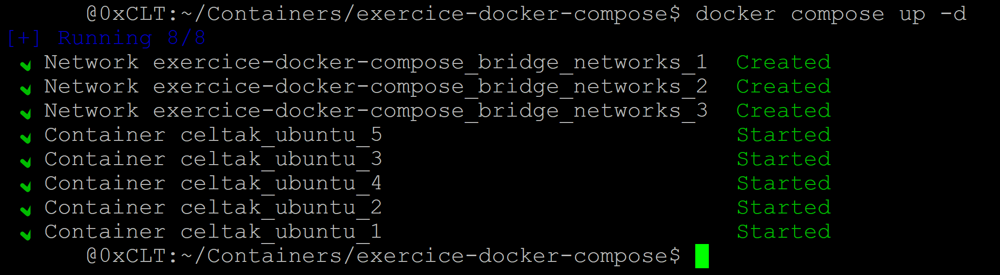

<!-- MASTER-HEADER-START -->
<div align="center">

<a href="https://0xcyberlitech.com/">
  
</a>

<p align="center">
  <a href="https://0xcyberlitech.com/"></a>
  <a href="https://0xcyberlitech.com/soc-rd.html"></a>
  <a href="https://0xcyberlitech.com/jarvis-rd.html"></a>
  <a href="https://github.com/0xCyberLiTech?tab=repositories"></a>
</p>
<p align="center">
  <a href="README.md"></a>
</p>


</div>
<!-- MASTER-HEADER-END -->

<!-- DEBIAN-TRUTH-START -->
> [!IMPORTANT]
>  ** Matrice Officielle Debian — `Debian 12 (Bookworm)` · `Debian 13 (Trixie)` · `Debian 14 (Forky)`**
> - **Sources Officielles Debian.org (`docker.io`) :** `Bookworm (12)` : **`20.10.24+dfsg1-1+deb12u1`** &nbsp;·&nbsp; `Trixie (13 — Stable)` : **`26.1.5+dfsg1-9+deb13u1`** &nbsp;·&nbsp; `Forky (14 — Next-Gen)` : **`28.5.2+dfsg4-5`**
> - **Références Officielles :** [Paquet Debian Trixie (`docker.io`)](https://packages.debian.org/trixie/docker.io) &nbsp;·&nbsp; [Paquet Debian Forky (`docker.io`)](https://packages.debian.org/forky/docker.io) &nbsp;·&nbsp; [Documentation Officielle Debian](https://wiki.debian.org/Docker)
> - **Note d'Ingénierie (Divergence 13 vs 14) :** Sous Debian 13 (Trixie) et Debian 14 (Forky), `apt-key` et l'ancien binaire Compose v1 n'existent plus : on utilise exclusivement `/etc/apt/keyrings/`, le format DEB822 `.sources` et **`docker compose` v2**.

<details>
<summary> <b>Afficher les Encarts Ligne de Commande : Debian 13 (Trixie — Stable) vs Debian 14 (Forky — Next-Gen)</b></summary>

####  Profil Production Stable — Commandes pour `Debian 13 (Trixie)`
```bash
# Debian 13 (Trixie) — Depot Docker au format moderne DEB822 (.sources) :
sudo install -m 0755 -d /etc/apt/keyrings
sudo curl -fsSL https://download.docker.com/linux/debian/gpg -o /etc/apt/keyrings/docker.asc
docker compose version && docker compose ps
```

####  Profil Anticipation Next-Gen — Commandes pour `Debian 14 (Forky)`
```bash
# Debian 14 (Forky) — Fichier /etc/apt/sources.list.d/docker.sources (Format DEB822 APT 3.0) :
# Types: deb
# URIs: https://download.docker.com/linux/debian
# Suites: trixie
# Components: stable
# Signed-By: /etc/apt/keyrings/docker.asc
```

</details>
<!-- DEBIAN-TRUTH-END -->

<!-- CIEL-PEDAGOGY-START -->
<details>
<summary> <b>Synthèse d'Architecture, Standards Officiels &amp; Diagnostic (Niveau 1 : Fondamentaux · Niveau 2 : Repères · Niveau 3 : Diagnostic)</b></summary>

- **Niveau 1 — Fondamentaux &amp; Principe d'Architecture :** **Docker Engine & Docker Compose** permettent d'isoler et d'exécuter des services applicatifs dans des **conteneurs légers** partageant le noyau Linux de l'hôte grâce aux primitives d'isolation du noyau (**Namespaces** et **cgroups v2**).
- **Niveau 2 — Repères Officiels (Ports IANA, Fichiers Debian &amp; Commandes de Validation) :** **Fichiers & Commandes :** `/etc/docker/daemon.json`, `compose.yaml` &nbsp;|&nbsp; **Validation & Exploitation :** `docker compose config` (validation syntaxique), `docker compose up -d`, `docker ps`, `docker inspect`, `docker network ls`.
- **Niveau 3 — Diagnostic d'Incidents &amp; Ingénierie Avancée :** **Diagnostic & Architecture :** Le réseau `bridge` par défaut (`docker0`) n'assure pas la résolution DNS par nom de conteneur ; déclarez toujours un **réseau bridge dédié** (`docker network create` ou via `compose.yaml`) afin d'activer le serveur DNS embarqué de Docker (`127.0.0.11`). Une **Image** est un modèle immuable en couches (OverlayFS), tandis qu'un **Conteneur** est son instance d'exécution.
- **Sources de Vérité Officielles Éditeurs &amp; Standards :** [Documentation Officielle Docker Engine](https://docs.docker.com/engine/) &nbsp;·&nbsp; [Spécification Officielle Docker Compose](https://docs.docker.com/compose/)

</details>
<!-- CIEL-PEDAGOGY-END -->


##  01 // DOCKER leçon 03 - Réseau.


- [Conteneurs connectés automatiquement.](#balise-01)
- [Créer un réseau.](#balise-02)
- [Connecter des conteneurs via des réseaux personnalisés.](#balise-03)
- [Tester les réseaux.](#balise-04)
 
Les réseaux dans docker-compose.yml

<a name="balise-01"></a>
-  ## Conteneurs connectés automatiquement.

Il faut savoir qu'automatiquement les conteneurs de notre fichier, sont connectés entre eux.

Nous allons vérifier cette affirmation.

Pour cela, modifions notre docker-compose.yml. 

En premier, on va supprimer le volume créé précédemment.

Pour manipuler les réseaux, il nous faut plusieurs conteneurs. 

Ce qui est logique, car il faut au minimum deux entités pour pourvoir les connecter.

Nous allons donc créer un autre service dans notre docker-compose.yml.

Nous allons baser ce conteneur sur la même image du service précédente et nous l'appellerons celtak_ubuntu_2. Le service par contre nous le nommerons my_ubuntu_2.

Et pour nous y retrouver, nous allons modifier le nom du premier service et le nom de son conteneur respectivement par celtak_ubuntu_1 et my_ubuntu_1.

Que ce passe-t-il si les noms de deux services sont identiques et les noms de deux conteneurs sont identiques ? Pour les services, un seul sera lancé  . Et s'il y a deux conteneurs qui portent le même, il y aura conflit sur les conteneurs  .

<!-- CODE-WINDOW-START -->
> [!CAUTION]
> 
>
> ```yaml
> version: '3.8'
>
> services:
>   my_ubuntu_1:
>     image: celtak/ubuntu-ping-ip
>     container_name: celtak_ubuntu_1
>     stdin_open: true
>     tty: true
>
>   my_ubuntu_2:
>     image: celtak/ubuntu-ping-ip
>     container_name: celtak_ubuntu_2
>     stdin_open: true
>     tty: true
> ```
<!-- CODE-WINDOW-END -->

Lancez les services du fichier grâce à la commande ci-dessous.

<!-- CODE-WINDOW-START -->
> [!CAUTION]
> 
>
> ```bash
> docker compose up -d
> ```
<!-- CODE-WINDOW-END -->



Maintenant ouvrez deux fenêtres du terminal et connectez-vous aux deux conteneurs (une connexion par fenêtre).

- Première fenêtre :

(Container - celtak_ubuntu_1)

<!-- CODE-WINDOW-START -->
> [!CAUTION]
> 
>
> ```bash
> docker exec -it e8bf1b5ec5bd bash
> ```
<!-- CODE-WINDOW-END -->

(Container - celtak_ubuntu_2)

<!-- CODE-WINDOW-START -->
> [!CAUTION]
> 
>
> ```bash
> docker exec -it 1d47b93872f3 bash
> ```
<!-- CODE-WINDOW-END -->

Dans le conteneur (celtak_ubuntu_1) tapez la commande ci-dessous.

<!-- CODE-WINDOW-START -->
> [!CAUTION]
> 
>
> ```bash
> ping celtak_ubuntu_2
> ```
<!-- CODE-WINDOW-END -->



- Deuxième fenêtre :

Dans le conteneur (celtak_ubuntu_2) tapez la commande ci-dessous.

<!-- CODE-WINDOW-START -->
> [!CAUTION]
> 
>
> ```bash
> ping celtak_ubuntu_1
> ```
<!-- CODE-WINDOW-END -->



Ils réussissent à communiquer ce qui affirme ce que nous avons dit juste avant.

Les conteneurs présents dans un fichier docker-compose.yml sont automatiquement connectés entre eux.

Mais est-il possible de personnalisé les choses ?

<a name="balise-02"></a>
- ## Créer un réseau.

La première étape pour utiliser des réseaux personnalisés, consiste à les créer.

Pour cela, il faut utiliser le mot-clé networks:. Ensuite, après tabulation, on pourra insérer le nom du réseau.

Pratiquons ce que nous venons de dire.

<!-- CODE-WINDOW-START -->
> [!CAUTION]
> 
>
> ```yaml
> version: '3'
>
> services:
>   my_ubuntu_1:
>     image: celtak/ubuntu-ping-ip
>     container_name: celtak_ubuntu_1
>     stdin_open: true
>     tty: true
>
>   my_ubuntu_2:
>     image: celtak/ubuntu-ping-ip
>     container_name: celtak_ubuntu_2
>     stdin_open: true
>     tty: true
>
> networks:
>   test_networks:
> ```
<!-- CODE-WINDOW-END -->

Dans notre exemple, nous avons déterminé un réseau personnalisé qui porte le nom test_networks:. 

Mais les deux conteneurs ne sont toujours pas connectés via ce réseau (mais par contre comme nous l'avons vu précédemment, ils le sont automatiquement via le réseau par défaut).

Il est possible de spécifier le type (ou pilotes) du réseau.

Pour l'exemple, nous allons spécifier le réseau bridge.

<!-- CODE-WINDOW-START -->
> [!CAUTION]
> 
>
> ```yaml
> version: '3'
>
> services:
>   my_ubuntu_1:
>     image: celtak/ubuntu-ping-ip
>     container_name: celtak_ubuntu_1
>     stdin_open: true
>     tty: true
>
>   my_ubuntu_2:
>     image: celtak/ubuntu-ping-ip
>     container_name: celtak_ubuntu_2
>     stdin_open: true
>     tty: true
>
> networks:
>   test_networks:
>     driver: bridge
> ```
<!-- CODE-WINDOW-END -->

Maintenant nous allons connecter les conteneurs entre eux.

<a name="balise-03"></a>
- ## Connecter des conteneurs via des réseaux personnalisés.

Pour bien comprendre le fonctionnement, nous allons utiliser cinq conteneurs.

- Les deux premiers seront reliés par un réseau. 
- Les deux suivants seront connectés par un autre réseau.
- Et enfin le dernier sera seul dans son réseau.

Nous allons utiliser un schéma pour entrevoir ce que nous souhaitons.



Désormais nous allons traduire le schéma dans le docker-compose.yml.

<!-- CODE-WINDOW-START -->
> [!CAUTION]
> 
>
> ```yaml
> version: '3'
>
> services:
>   my_ubuntu_1:
>     image: celtak/ubuntu-ping-ip
>     container_name: celtak_ubuntu_1
>     stdin_open: true
>     tty: true
>     networks:
>       - bridge_networks_1 
>
>   my_ubuntu_2:
>     image: celtak/ubuntu-ping-ip
>     container_name: celtak_ubuntu_2
>     stdin_open: true
>     tty: true
>     networks:
>       - bridge_networks_1 
>
>   my_ubuntu_3:
>     image: celtak/ubuntu-ping-ip
>     container_name: celtak_ubuntu_3
>     stdin_open: true
>     tty: true
>     networks:
>       - bridge_networks_2 
>
>   my_ubuntu_4:
>     image: celtak/ubuntu-ping-ip
>     container_name: celtak_ubuntu_4
>     stdin_open: true
>     tty: true
>     networks:
>       - bridge_networks_2 
>
>   my_ubuntu_5:
>     image: celtak/ubuntu-ping-ip
>     container_name: celtak_ubuntu_5
>     stdin_open: true
>     tty: true
>     networks:
>       - bridge_networks_3
>
> networks:
>   bridge_networks_1:
>     driver: bridge
>   bridge_networks_2:
>     driver: bridge
>   bridge_networks_3:
>     driver: bridge
> ```
<!-- CODE-WINDOW-END -->

Analysons le contenu du fichier.

Comme indiqué en haut, nous avons créé trois réseaux bridge.

Nous avons par la suite, rattaché les cinq conteneurs aux réseaux selon les détails du schéma. Pour les relier à des réseaux, nous avons utilisé le mot-clé networks: suivi du nom du réseau. Par exemple - bridge_networks_1.

Testons les choses afin de vérifier le système.

Commençons par lancer le docker-compose.yml.

<!-- CODE-WINDOW-START -->
> [!CAUTION]
> 
>
> ```bash
> docker compose up -d
> ```
<!-- CODE-WINDOW-END -->



<a name="balise-04"></a>
- ## Tester les réseaux.

Maintenant, il est possible de faire des tests.

Normalement à ce stade, vous savez les faire.

Je ne vais donc pas vous montrer les commandes. Je vais juste vous proposer des tests sous formes de question.

Je vous encourage à tester de votre côté pour bien comprendre.

Est-ce qu'il est possible de faire communiquer my_ubuntu_1 et my_ubuntu_2 ?

Oui, car ils font parties du même réseau.

Pouvons-nous transmettre des informations à my_ubuntu_3 à partir de my_ubuntu_1 ?

Non ce n'est pas possible. Ils ne font pas partie du même réseau.

Avec my_ubuntu_5, sur quels conteneurs je peux communiquer ?

Aucun d'entre eux, car my_ubuntu_5 est seul dans son réseau.

Parfait  ! Vous savez à présent bien utiliser les réseaux via le docker-compose.yml.

<!-- MASTER-FOOTER-START -->
<div align="center">


<a href="https://0xcyberlitech.com/">
  
</a>

<p align="center"><a href="https://0xcyberlitech.com/"></a></p>

<sub><b>Architecturé &amp; Forgé par Marc &amp; Antigravity (Google DeepMind)</b> &nbsp;·&nbsp; <a href="https://0xcyberlitech.com/"><b>0xcyberlitech.com</b></a> &nbsp;·&nbsp; <a href="https://0xcyberlitech.com/soc-rd.html">Architecture SOC Cockpit v5.5</a> &nbsp;·&nbsp; <a href="https://0xcyberlitech.com/jarvis-rd.html">Architecture JARVIS Mark-VII</a> &nbsp;·&nbsp; <a href="https://0xcyberlitech.com/blueprint-jarvis.html">Blueprint Matériel RTX 5080</a></sub>

</div>
<!-- MASTER-FOOTER-END -->
